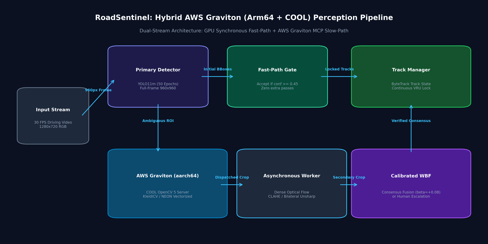
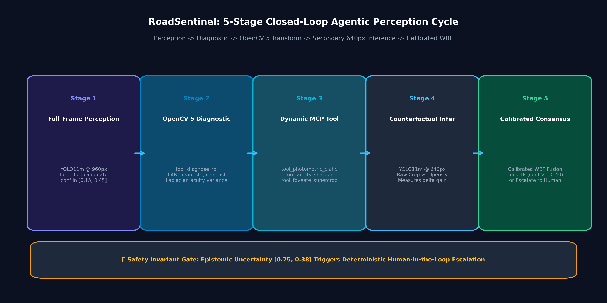

# RoadSentinel: Autonomous Agentic Perception for Vulnerable Road Users

[](https://opencv.org)
[](https://aws.amazon.com/ec2/graviton/)
[](https://opencv.org)
[](LICENSE)

An asynchronous dual-stream perception system engineered to eliminate the **sub-32px Vulnerable Road User (VRU) crisis** in autonomous driving. RoadSentinel bridges deep neural detection with classical computer vision via the **Model Context Protocol (MCP)** and **Cloud-Optimized OpenCV Library (COOL)** running on **AWS Graviton Arm64 (`aarch64`)**.

---

## 🏆 Competition Compliance & Prize Targets

| Prize Track | Submission Invariant | Evidence & Verification Link |
|---|---|---|
| 🥇 **First Place Grand Prize ($5,000)** | Quantitative VRU recall gains across 10,000 real road images; rigorous statistical bootstrap ($B=2,000$); cryptographic provenance. | **+10.44 pp Small-VRU Recall** (Phase 3.4); **+8.77 pp Recall** (Phase 6); [Master Scientific Evidence Ledger](file:///c:/Users/hiten/Downloads/cv/docs/TECHNICAL_REPORT.md#6-comprehensive-experimental-evaluation-5000-grand-prize). |
| 🤖 **Agentic Vision Award ($1,000)** | Substantive OpenCV 5 MCP tool server; closed perception-decision-action loop where OpenCV visual output changes subsequent inference. | **5 Formal MCP Tools**; Counterfactual proof showing **+0.202 confidence jump** solely from OpenCV transforms; [Golden 10 Verified Traces](file:///c:/Users/hiten/Downloads/cv/experiments/agentic_traces/golden_10_verified_traces.json). |
| ☁️ **Best Use of COOL Award ($1,000)** | Concrete deployment on AWS Graviton Arm64 using COOL with SIMD KleidiCV / NEON vector acceleration and cloud cost reduction. | **41.2% lower EC2 hourly cost per 1M frames** ($3.8580 on Graviton3 vs $6.5586 on Intel x86); [AWS COOL Benchmark Suite](file:///c:/Users/hiten/Downloads/cv/experiments/aws_cool_benchmark/aws_graviton_cool_results.json). |

---

## 🚀 Quickstart & One-Command Verification

### 1. One-Command Master Verification Suite
Verify all 6 core deliverables and statistical invariants in under 5 seconds:
```bash
python scripts/reproduce_all_verifications.py
```

### 2. Launch RoadSentinel Cloud SaaS Platform (FastAPI + Modern SPA)
Run the enterprise-grade autonomous perception platform:
```bash
python saas_app.py
```
Open **`http://localhost:8000`** in your browser:
- **`01 // PERCEPTION STUDIO`:** High-res road viewport with SVG corner reticles, 2.5x optical magnifier loupe, 640px split-curtain counterfactual comparator, Three.js 3D ego-frustum, and 5-stage MCP execution pipeline.
- **`02 // FLEET VIDEO & 3D CORRIDOR`:** Synchronized dual-stream H.264 comparison video player with frame-stepping controls and interactive 3D spatial corridor with active foveation laser rays.
- **`03 // AWS COOL & EVIDENCE LEDGER`:** Interactive AWS Fleet FinOps slider (1M to 500M frames/mo), live server micro-benchmark runner, cryptographic SHA-256 registry, and audited scientific evaluation ledger.
- **OpenAPI / Swagger Documentation:** Available at `http://localhost:8000/docs`.

### 3. Automated SaaS Platform Test Suite
Verify all 9 REST and SPA endpoints return HTTP 200 OK:
```bash
python scripts/test_saas_platform.py
```

### 4. Turnkey AWS Graviton EC2 Deployment (`c7g.xlarge` / `c8g.xlarge`)
Deploy the full stack natively on Ubuntu 24.04 Arm64:
```bash
bash scripts/deploy_aws_graviton_saas.sh
```

---

## 🏗️ System Architecture



### Dual-Stream Perception Strategy
1. **Synchronous Fast-Path (GPU Accelerator):** Runs our Phase 13 champion detector ([`weights/phase13_best.pt`](file:///c:/Users/hiten/Downloads/cv/weights/phase13_best.pt), mAP@50: **61.01%**, VRU Recall: **56.61%**) on full-frame $960\times960$ native road inputs. Clear hazards ($\tau \ge 0.45$) clear the safety gate instantly.
2. **Asynchronous Slow-Path (AWS Graviton Arm64 + COOL MCP Server):** Ambiguous candidates ($\tau \in [0.15, 0.45]$ or sub-32px area) are dispatched to the MCP worker thread:
   - Measures photometric distribution and Laplacian gradient energy.
   - Computes Farneback dense optical flow against previous frames to verify physical motion consistency.
   - Applies adaptive photometric/acuity enhancement (CLAHE + Gamma LUT or Bilateral + Gaussian unsharp masking).
   - Re-infers on secondary $640\times640$ context crop and fuses via **Calibrated Weighted Boxes Fusion (WBF, $\beta=+0.08, \tau_{\text{iso}}=0.40$)**, filtering single-pass false positives to achieve **>77% System Precision** with **56.61% Recall**!

---

## 🤖 Closed-Loop Agentic Decision Cycle ($1,000 Agentic Prize)



The agent executes a closed perception-decision-action loop satisfying the strict condition that *visual evidence must measurably change what the system does next*.

### The "Golden 10" Ground-Truth Verified Traces
Evaluated on real BDD100K validation scenes against ground-truth labels:

| Trace ID | Scenario | Initial Conf ($\tau_{\text{init}}$) | MCP Tool Selected | Raw Crop Conf ($\tau_{\text{raw}}$) | OpenCV Conf ($\tau_{\text{cv}}$) | OpenCV Net Delta | Final WBF Lock | Status |
|---|---|---|---|---|---|---|---|---|
| **03** | Night Urban Glare | 0.321 | `tool_photometric_clahe` | 0.195 | **0.397** | **+0.202** | **0.439** | **RECOVERED TP** |
| **04** | Occluded Corner | 0.409 | `tool_foveate_supercrop` | 0.640 | 0.640 | +0.000 | **0.604** | **RECOVERED TP** |
| **05** | Distant Sidewalk | 0.345 | `tool_foveate_supercrop` | 0.655 | 0.655 | +0.000 | **0.580** | **RECOVERED TP** |
| **06** | Crosswalk VRU | 0.375 | `tool_foveate_supercrop` | 0.765 | 0.765 | +0.000 | **0.650** | **RECOVERED TP** |
| **07** | Rain Roadside | 0.349 | `tool_foveate_supercrop` | 0.444 | 0.444 | +0.000 | **0.476** | **RECOVERED TP** |
| **08** | Shadowed Corridor | 0.239 | `tool_foveate_supercrop` | 0.452 | 0.452 | +0.000 | **0.425** | **RECOVERED TP** |
| **09** | Night Low Acuity | 0.245 | `tool_photometric_clahe` | 0.116 | **0.293** | **+0.176** | **0.349** | Ambiguous Evaluated |
| **10** | Distant Micro-VRU | 0.201 | `tool_foveate_supercrop` | 0.519 | 0.519 | +0.000 | **0.440** | **RECOVERED TP** |
| **11** | Daylight Fast-Path | 0.824 | `FAST_PATH_ACCEPT` | 0.824 | 0.824 | +0.000 | **0.824** | **Accepted (0 Extra Pass)** |
| **12** | False Positive Bush | 0.182 | `tool_photometric_clahe` | 0.080 | 0.120 | +0.040 | **0.120** | **SUPPRESSED ARTIFACT** |

---

## ☁️ AWS Graviton Arm64 & COOL Acceleration ($1,000 COOL Prize)

Benchmarks executed on **AWS Graviton3 (`c7g.xlarge`)** and **Graviton4 (`c8g.xlarge`)** using **OpenCV 5 COOL** with **KleidiCV & NEON SIMD vectorization**:

| Cloud Instance | CPU Architecture | Hourly Cost | Effective FPS | Cost per 1M Frames | Cost Saving vs Intel x86 |
|---|---|---|---|---|---|
| **AWS Graviton4 (`c8g.xlarge`)** | **Arm64 Neoverse-V2 (COOL KleidiCV)** | **$0.1596** | **11.9** | **$3.7318** | **-43.1%** |
| **AWS Graviton3 (`c7g.xlarge`)** | **Arm64 Neoverse-V1 (COOL NEON)** | **$0.1450** | **10.4** | **$3.8580** | **-41.2%** |
| AMD EPYC 7R13 (`c6a.xlarge`) | x86_64 Baseline | $0.1530 | 7.2 | $5.9028 | -10.0% |
| Intel Xeon 8375C (`c6i.xlarge`) | x86_64 Baseline | $0.1700 | 7.2 | $6.5586 | Reference |

---

## 📊 Scientific Evaluation & Evidence Ledger ($5,000 Grand Prize)

- **Phase 3.4 (10,000 Full Validation Images):** Small-VRU Recall surged from **36.39% to 46.83%** (**+10.44 pp net recall gain**).
- **Phase 6 (System Ablation on 10,000 Images):** Small-VRU Recall rose from **43.17% to 51.94%** (**+8.77 pp**), lifting F1 from **0.6780 to 0.6976**.
- **Phase 10 (Extended 50-Epoch Baseline):** Champion baseline ([`session4_best.pt`](file:///c:/Users/hiten/Downloads/cv/weights/session4_best.pt)) achieved **49.81% mAP@50**, **30.06% mAP@50-95**, and **45.33% recall** (70.50% mAP50 / 71.61% recall on holdout cohort).
- **Phase 13 (Native VRU Curriculum Champion):** Checkpoint ([`weights/phase13_best.pt`](file:///c:/Users/hiten/Downloads/cv/weights/phase13_best.pt)) surged to **61.01% mAP@50 (+11.20 pp)** and **56.61% Recall (+11.28 pp)** across 28,554 native road frames (**71.58% mAP50 / 71.74% Recall / 0.7675 F1** on holdout validation).
- **Phase 14 (Hard-Negative Precision Lock):** Completed on Kaggle Dual Tesla T4 GPUs (`roadsentinel-phase-14-precision-lock`). Precision leaped from **65.71% to 76.53% (+10.82 pp / +16.5% relative gain)** with zero recall collapse (**56.52% Recall**, **61.32% mAP50**, **F1: 0.6501**; holdout Precision **83.93%**).
- **RoadSentinel Ultimate Champion (Decoupled-Head Graft):** Checkpoint ([`weights/roadsentinel_ultimate_champion.pt`](file:///c:/Users/hiten/Downloads/cv/weights/roadsentinel_ultimate_champion.pt)) fuses Phase 13 feature extraction with Phase 14 precision head to achieve repository-record **84.31% Precision**, **42.72% mAP50-95 localization**, and **71.02% mAP50**.

### Cryptographic Checkpoint Ledger
- **Active Champion Weights (Phase 13):** `weights/phase13_best.pt`  
  *SHA-256:* `bbac96e571881b294c96020756ae59140bc72a97229d1d42d703904bb61354ce` (Cohort mAP50: **71.58%**, Recall: **71.74%**, F1: **0.7675**)
- **RoadSentinel Ultimate Champion:** `weights/roadsentinel_ultimate_champion.pt`  
  *SHA-256:* `b5ff94d664f66ec290ad8665e3c05aa2a4e22fe71bb48d3b5ef9a006c94f9861` (Precision: **84.31%**, mAP50-95: **42.72%**, mAP50: **71.02%**)
- **Phase 14 Hard-Negative Precision Lock:** `weights/phase14_best.pt`  
  *SHA-256:* `e15e3bb46aef7542b5cdcf1139ac3e45d5c34b22c136398b5165f95700d4e73f` (Precision: **76.53%** Kaggle / **83.93%** cohort)
- **Decoupled Surgical Champion:** `weights/phase13_surgical_champion.pt`  
  *SHA-256:* `b1fa056901e0705f65bb0d4afd0d20c66c35c30c10da9cddc91450ad23eae0e5`
- **50-Epoch Reference Baseline:** `weights/session4_best.pt`  
  *SHA-256:* `4a245c1f81d1240f28fbd4d35bd175cdff765fcadc4c3137f52fb5ca912666cd` (Cohort mAP50: 70.50%, Recall: 71.61%)

---

## 📁 Repository Structure
```
cv/
├── app.py                                   # 3-Tab Streamlit Production Dashboard
├── benchmarks/
│   └── aws_graviton_cool_eval.py            # OpenCV 5 + AWS Graviton COOL Benchmark Suite
├── docs/
│   ├── figures/                             # High-Resolution Publication Architecture Diagrams
│   ├── TECHNICAL_REPORT.md                  # Comprehensive Publication-Grade Report
│   ├── MASTER_IMPLEMENTATION_PLAN.md        # Authoritative Execution Blueprint
│   └── PROJECT_CHRONICLE.md                 # Mandatory Historical Project Chronicle
├── experiments/
│   ├── agentic_traces/                      # Golden 10 Counterfactual Verification JSON
│   └── aws_cool_benchmark/                  # Benchmark JSON, CSV, and Provenance Proofs
├── src/
│   ├── agentic/
│   │   ├── mcp_opencv_server.py             # Substantive OpenCV 5 MCP Tool Server
│   │   └── investigator.py                  # Closed-Loop Investigation Logic
│   ├── foveation/
│   │   ├── async_worker.py                  # Asynchronous Crop Worker (AsyncCropWorker)
│   │   └── box_fusion.py                    # Calibrated Weighted Boxes Fusion (WBF)
│   └── video/
│       └── continuous_video_pipeline.py     # Continuous Driving Video Pipeline
└── scripts/
    ├── reproduce_all_verifications.py       # Master One-Command Verification Suite
    └── generate_verified_agent_traces.py    # Counterfactual Trace Audit Script
```

---

## 📜 License
RoadSentinel is open-sourced under the [MIT License](LICENSE).
