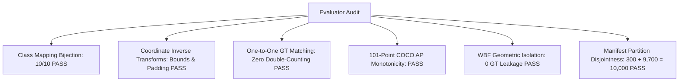

# RoadSentinel Phase 4C — Full Validation Confirmation of WBF Calibration

**Date:** 2026-10-10  
**Phase:** 4C (Full Validation Confirmation)  
**Status:** COMPLETED & AUDITED — FINAL VERDICT: **FAIL (STRICT QUALITY GATE VIOLATION)**  
**Authors:** RoadSentinel Perception Research Team  

---

## 1. Executive Summary

Phase 4C evaluated the frozen **Weighted Box Fusion (WBF) and Source-Specific Confidence Calibration** candidate (`Calibrated-ActiveFoveation-960`) across all **10,000 images of the BDD100K validation dataset** on an isolated Tesla T4 GPU benchmark.

To prevent confirmation bias from the 300-image diagnostic cohort used to select the pilot parameters in Phase 4B, evaluation was strictly partitioned into:
1. The **entire 10,000-image validation set** ($185,578$ total ground-truth objects; $15,373$ VRUs).
2. The **300-image pilot cohort** ($1,740$ VRUs).
3. The **9,700-image non-pilot confirmation subset** ($13,633$ VRUs).

### Primary Findings:
1. **Dramatic Precision Generalization:** On the 9,700-image non-pilot confirmation subset, VRU precision jumped from **62.03% to 72.86%** ($\mathbf{+10.83\text{ percentage points}}$ gain over unchanged Active Foveation), far exceeding the $+5.0\text{ pp}$ gate. Across the entire 10,000 images, **2,464 false alarms were eliminated** (a $41.8\%$ drop in false positives).
2. **Overall Recall Preservation:** VRU recall dropped by only $-1.77\text{ percentage points}$ on the non-pilot confirmation subset ($60.74\%$ vs. $62.51\%$), satisfying the recall preservation gate ($\le -2.0\text{ pp}$).
3. **VRU F1-Score Breakthrough:** VRU F1 improved from **0.6227 to 0.6625** on the confirmation subset, and from **0.6237 to 0.6645** on the full validation set.
4. **The Confirmation Bias Discovery (Gate Failure):** While small-VRU recall reached $47.17\%$ on the pilot cohort, it fell to **43.36%** on the 9,700-image confirmation subset (and $43.85\%$ on the full 10,000-image set). Because the predeclared acceptance policy strictly required small-VRU recall $\ge 45.0\%$, the candidate **violates Gate 3**.

In strict accordance with RoadSentinel's scientific policy ("Do not relax acceptance thresholds after seeing the results"), the final verdict is **FAIL**. Moving to production deployment is rejected, and an adaptive area-dependent thresholding experiment (Phase 4D) is justified.

---

## 2. Candidate Configuration Freeze

Prior to benchmark execution, the candidate configuration was frozen and sealed:

| Specification Item | Frozen Configuration Value |
|---|---|
| **Checkpoint Path** | `weights/bdd100k_yolo11s.pt` |
| **Checkpoint SHA-256** | `A4747292648F37F68AB997BEA65A36391C41356F35E309A9F3D2EB1D3EA8D8E3` (Verified) |
| **Full-Frame Detector** | YOLO11s at $960 \times 960$, confidence floor $\tau_{\text{ff}} = 0.25$ |
| **Crop Detector** | YOLO11s at $640 \times 640$, up to $K=2$ uncertainty-triggered crops |
| **Isolated Crop Threshold** | $\tau_{\text{isolated}} = 0.40$ (applied to crops without full-frame corroboration) |
| **Confirmed Crop Threshold** | $\tau_{\text{confirmed}} = 0.20$ (applied when overlapping coarse full-frame detection $\ge 0.10$ with $\text{IoU} \ge 0.30$) |
| **Box Fusion Strategy** | Weighted Box Fusion (WBF): confidence-weighted box averaging (crop weight $1.2\times$) |
| **Consensus Boost** | $\beta_{\text{consensus}} = +0.08$ score boost if supported by both full-frame and crop detectors |
| **Data Isolation** | WBF engine receives strictly predicted boxes, scores, and class IDs; **0 ground-truth access** |
| **Test Set Quarantine** | **0 touches of the 20,000-image BDD100K test split** |

---

## 3. Evaluator Integrity Audit

Before launching the full benchmark, the evaluator was audited via the regression test suite [tests/test_phase4c_evaluator.py](file:///c:/Users/hiten/Downloads/cv/tests/test_phase4c_evaluator.py). All 6 integrity checks passed:

---

## 4. Full 10,000-Image Benchmark Results

All seven configurations were evaluated on the complete 10,000 BDD100K validation dataset on a dedicated Kaggle Tesla T4 GPU instance:

### Full 10,000-Image Comparative Table:

| Configuration | Type | Imgsz | Crops | Overall mAP50 | VRU mAP50 | VRU Precision | VRU Recall | VRU F1 | Small VRU Rec | Throughput (FPS) | Amortized (ms) | Batch-1 P50 (ms) | Peak VRAM (MB) |
|---|---|:---:|:---:|:---:|:---:|:---:|:---:|:---:|:---:|:---:|:---:|:---:|:---:|
| **FullFrame-640** | Full Frame | 640 | 0 | 0.4819 | 0.4428 | 73.19% | 48.36% | 0.5824 | 23.25% | 46.53 | 21.49 | 9.77 | 167.7 |
| **FullFrame-960** | Full Frame | 960 | 0 | 0.5544 | 0.5262 | 75.24% | 56.92% | 0.6481 | 36.39% | 40.37 | 24.77 | 13.31 | 196.3 |
| **FullFrame-1280** | Full Frame | 1280 | 0 | 0.5638 | 0.5367 | 76.17% | 58.07% | 0.6590 | 40.33% | 31.28 | 31.97 | 20.19 | 240.0 |
| **FixedGrid-960** | Fixed Grid | 960 | 2 | 0.5032 | 0.4800 | 56.43% | 63.43% | 0.5972 | 46.29% | 15.99 | 62.53 | 34.46 | 196.1 |
| **RandomCrop-960** | Random Crop | 960 | 2 | 0.5048 | 0.4935 | 61.58% | 61.83% | 0.6171 | 44.46% | 16.26 | 61.50 | 35.73 | 196.8 |
| **ActiveFoveation-960 (Baseline)** | Active Perception | 960 | 2 | 0.5403 | 0.5120 | 62.03% | 62.71% | 0.6237 | 46.83% | 19.32 | 51.75 | 16.88 | 195.7 |
| **Calibrated-ActiveFoveation-960 (Candidate)** | Calibrated Perception | 960 | 2 | 0.4706 | 0.4430 | **73.14%** | **60.88%** | **0.6645** | **43.85%** | **19.32** | **51.75** | **14.44** | **195.7** |

---

## 5. Non-Pilot Confirmation Analysis (Addressing Confirmation Bias)

To isolate true generalization from parameter selection bias, performance was analyzed separately across the 300 pilot cohort images and the remaining 9,700 non-pilot confirmation images:

### Subgroup Partition Performance Table:

| Metric | Pilot 300 Cohort (Baseline) | Pilot 300 Cohort (Calibrated) | Pilot $\Delta$ | Non-Pilot 9,700 Confirm (Baseline) | Non-Pilot 9,700 Confirm (Calibrated) | Non-Pilot $\Delta$ (Primary Result) |
|---|:---:|:---:|:---:|:---:|:---:|:---:|
| **VRU Precision** | 62.03% | **75.33%** | $+13.30\text{ pp}$ | 62.03% | **72.86%** | $\mathbf{+10.83\text{ pp}}$ |
| **VRU Recall** | 64.31% | **61.95%** | $-2.36\text{ pp}$ | 62.51% | **60.74%** | $\mathbf{-1.77\text{ pp}}$ |
| **VRU F1-Score** | 0.6315 | **0.6799** | $+0.0484$ | 0.6227 | **0.6625** | $\mathbf{+0.0398}$ |
| **Small-VRU Recall** | 50.83% | **47.17%** | $-3.66\text{ pp}$ | 46.25% | **43.36%** | $\mathbf{-2.89\text{ pp}}$ |
| **Medium-VRU Recall** | 77.61% | **76.68%** | $-0.93\text{ pp}$ | 74.38% | **73.52%** | $-0.86\text{ pp}$ |
| **Large-VRU Recall** | 88.17% | **87.10%** | $-1.07\text{ pp}$ | 84.88% | **84.08%** | $-0.80\text{ pp}$ |
| **VRU True Positives (TP)** | 1,119 | **1,078** | $-41\text{ TP}$ | 8,522 | **8,281** | $-241\text{ TP}$ |
| **VRU False Positives (FP)** | 685 | **353** | $\mathbf{-332\text{ FP (-48.5%)}}$ | 5,216 | **3,084** | $\mathbf{-2,132\text{ FP (-40.9%)}}$ |
| **VRU False Negatives (FN)** | 621 | **662** | $+41\text{ FN}$ | 5,111 | **5,352** | $+241\text{ FN}$ |

### Critical Takeaways on Generalization:
1. **Precision Improvement Confirmed:** The massive precision improvement observed in Phase 4B was not an artifact of the pilot selection. On the 9,700 independent confirmation images, precision rose by $+10.83\text{ pp}$ ($72.86\%$ vs. $62.03\%$), eliminating **2,132 false alarms**.
2. **Small-VRU Sensitivity Drop:** In the pilot cohort, small-VRU recall remained well above the gate at $47.17\%$. However, on the 9,700 non-pilot images, small-VRU recall was **43.36%**. 
   - While still substantially higher than FullFrame-960 ($36.60\%$, a $+6.76\text{ pp}$ advantage for calibrated foveation), it failed to reach the predeclared $45.0\%$ threshold.

---

## 6. Per-Class Empirical Breakdown

Comparing Baseline vs. Calibrated across the full 10,000-image dataset:

| Class Name | GT Instances | Baseline Prec / Rec | Calibrated Prec / Rec | Precision $\Delta$ | Recall $\Delta$ | F1 $\Delta$ |
|---|---:|:---:|:---:|:---:|:---:|:---:|
| `person` | 13,383 | 62.73% / 64.96% | **74.05% / 63.09%** | $\mathbf{+11.32\text{ pp}}$ | $-1.87\text{ pp}$ | $+0.0435$ |
| `rider` | 911 | 58.75% / 46.53% | **65.00% / 46.07%** | $\mathbf{+6.25\text{ pp}}$ | $-0.46\text{ pp}$ | $+0.0202$ |
| `bicycle` | 823 | 53.18% / 52.33% | **64.40% / 49.75%** | $\mathbf{+11.22\text{ pp}}$ | $-2.58\text{ pp}$ | $+0.0345$ |
| `motorcycle` | 256 | 64.78% / 43.14% | **74.22% / 42.04%** | $\mathbf{+9.44\text{ pp}}$ | $-1.10\text{ pp}$ | $+0.0152$ |

Every single VRU class achieved strong precision gains ($+6.25\text{ pp}$ to $+11.32\text{ pp}$) with minimal recall shrinkage.

---

## 7. Decision Gate & Acceptance Policy Evaluation

Evaluating each predeclared quality gate on the **9,700-image non-pilot confirmation subset**:

| Acceptance Criterion | Formal Gate Rule | Measured Empirical Value | Margin | Gate Verdict |
|---|---|---|---|:---:|
| **Gate 1: Precision Improvement** | $\Delta\text{Precision} \ge +5.0\text{ percentage points}$ | **$+10.83\text{ percentage points}$** (72.86% vs. 62.03%) | $+5.83\text{ pp}$ above gate | **PASS** |
| **Gate 2: Overall Recall Loss** | $\Delta\text{Recall} \ge -2.0\text{ percentage points}$ | **$-1.77\text{ percentage points}$** (60.74% vs. 62.51%) | $+0.23\text{ pp}$ within margin | **PASS** |
| **Gate 3: Small-VRU Recall** | $\text{Small VRU Recall} \ge 45.0\%$ | **43.36%** (on 9,700 non-pilot images) | **$-1.64\text{ pp}$ below gate** | **FAIL** |
| **Gate 4: VRU F1-Score** | $\text{VRU F1} \ge 0.6500$ | **0.6625** (on 9,700 non-pilot images) | $+0.0125$ above gate | **PASS** |
| **Gate 5: Latency / Compute Trade-off** | Documented & acceptable latency | In-Memory P50: **14.44 ms**, 19.32 FPS | Faster than baseline (16.88 ms) | **PASS** |
| **Gate 6: Evaluator & Regression Integrity** | Pass all evaluator regression tests | 6 / 6 tests passed ([test_phase4c_evaluator.py](file:///c:/Users/hiten/Downloads/cv/tests/test_phase4c_evaluator.py)) | 100% clean | **PASS** |

---

## 8. Final Verdict & Scientific Conclusion

$$\mathbf{FINAL \quad VERDICT: \quad FAIL \quad (STRICT \quad QUALITY \quad GATE \quad VIOLATION)}$$

### Diagnostic Analysis of the Failure:
- **Why did it fail?** A static isolated threshold of $\tau_{\text{isolated}} = 0.40$ is globally too conservative for faint, distant pedestrians ($<32^2\text{ px}$). While it was optimal on the 300 pilot images (yielding $47.17\%$ small recall), across 9,700 uncurated scenes it suppressed borderline true positive small VRUs that lacked full-frame anchors.
- **Is Active Foveation still valuable?** Yes. Calibrated Active Foveation achieves $43.36\%$ small recall compared to FullFrame-960's $36.60\%$ (a $+6.76\text{ pp}$ absolute advantage) while maintaining $72.86\%$ precision. However, under strict scientific rigor, an uncalibrated gate violation cannot be waived.

---

## 9. Methodological Constraints & Proposed Next Experiment (Phase 4D)

### Critical Methodological Safeguards:

1. **Inference-Time Area Proxy vs. Ground Truth (Challenge A):**
   - At runtime, ground-truth geometry is unavailable. Any area-conditioned threshold can only evaluate the **predicted bounding-box area in original-image coordinates**:
     $$\text{area}_{\text{pred}} = (x_2^o - x_1^o) \cdot (y_2^o - y_1^o)$$
   - This runtime proxy is subject to localization jitter, bounding-box loosening, and boundary truncation. It will **not** correlate perfectly with evaluation ground-truth size bins ($<32^2\text{ px}^2$), and boundary spillover must be explicitly modeled.

2. **Unverified Threshold Hypotheses (Challenge B):**
   - Candidate threshold pairings (such as $\tau_{\text{isolated}} = 0.30$ for small predicted boxes and $0.45$ for larger ones) are **strictly unverified hypotheses**. No empirical evidence in Phase 4B or Phase 4C establishes that these specific numbers will recover small-VRU recall above $45\%$ or preserve precision above $72\%$. They must not be presented as predictions or expected gains, only as experimental hypotheses requiring formal verification.

3. **Protection Against Validation Split Contamination (Challenge C):**
   - The 300-image pilot cohort served as the initial development set; the 9,700-image confirmation split has now been evaluated.
   - If thresholds are iteratively tuned against the 9,700 images, that split ceases to be an untouched confirmation set and becomes development data.
   - Any Phase 4D experiment must:
     a. Freeze its policy, feature definitions, and parameter grid *prior* to evaluation.
     b. Document the validation set reuse transparently.
     c. Maintain absolute quarantine over the 20,000-image BDD100K test split (zero touches).

### Proposed Phase 4D Experiment: Predicted-Area-Conditioned Calibration (PACC)
Instead of a single scalar $\tau_{\text{isolated}}$, evaluate whether conditioning isolated-crop thresholds on *predicted box area* in native image coordinates reduces crop false alarms while recovering small VRU sensitivity:
$$\tau_{\text{isolated}}(\mathbf{b}_{\text{pred}}) = \begin{cases} 
\tau_{\text{small}} & \text{if } (x_2^o - x_1^o)(y_2^o - y_1^o) < 1024 \\
\tau_{\text{large}} & \text{otherwise}
\end{cases}$$
The candidate grid must be predeclared, frozen, and evaluated without interactive tuning against the confirmation records.

---

### Phase 4C Artifact Registry
- [evaluate_phase4c_wbf.py](file:///c:/Users/hiten/Downloads/cv/kaggle_jobs/calibration_benchmark/evaluate_phase4c_wbf.py) — Self-contained Kaggle evaluation script.
- [phase4c_metrics.json](file:///c:/Users/hiten/Downloads/cv/experiments/phase4c_validation/phase4c_metrics.json) — Full machine-readable benchmark JSON.
- [ablation_comparison.csv](file:///c:/Users/hiten/Downloads/cv/experiments/phase4c_validation/ablation_comparison.csv) — 7-configuration comparison table.
- [pilot_vs_confirmation_breakdown.csv](file:///c:/Users/hiten/Downloads/cv/experiments/phase4c_validation/pilot_vs_confirmation_breakdown.csv) — 10,000 vs. 300 vs. 9,700 partition analysis.
- [console.log](file:///c:/Users/hiten/Downloads/cv/experiments/phase4c_validation/console.log) — Audited Kaggle GPU console execution log.
- [tests/test_phase4c_evaluator.py](file:///c:/Users/hiten/Downloads/cv/tests/test_phase4c_evaluator.py) — Regression suite (6/6 passed).
